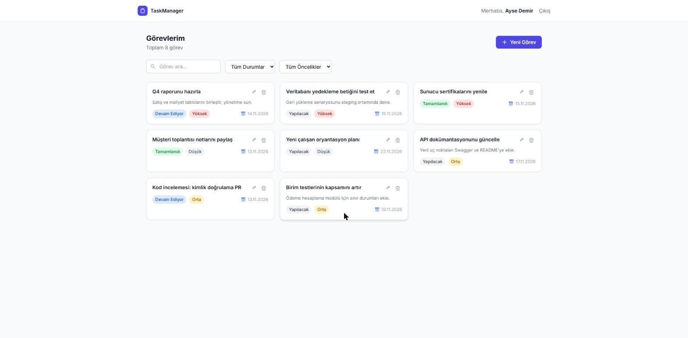
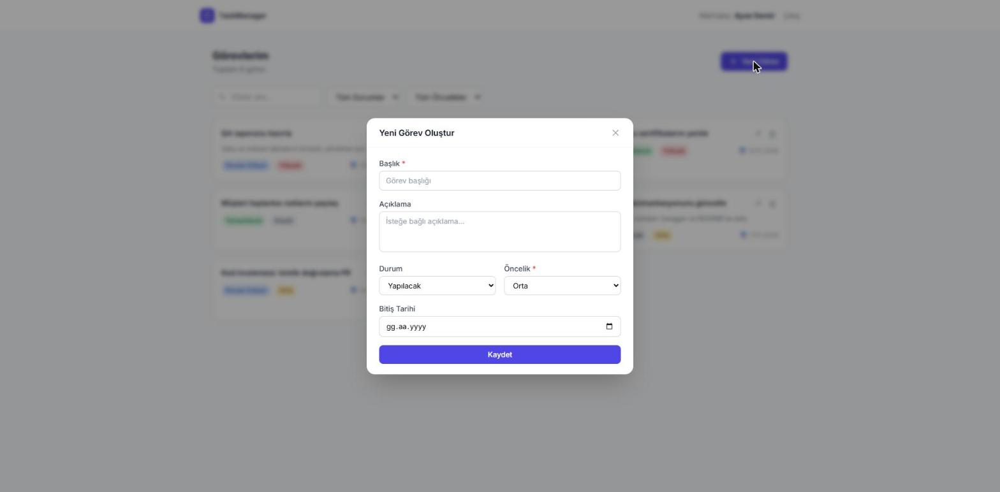

# Task Manager – Görev Yönetimi Uygulaması

 

> **English summary:** A full-stack task manager: a Laravel 11 REST API with token authentication (Sanctum), policies and soft deletes, and a Next.js 14 (App Router) frontend with React Query. 22 backend and 11 frontend tests, CI on GitHub Actions.

Token tabanlı kimlik doğrulamalı bir **Laravel 11** REST API'si ile **Next.js 14** (App Router) arayüzünden oluşan, uçtan uca bir görev yönetimi uygulaması.

---

## Özellikler

- Token tabanlı kimlik doğrulama (Laravel Sanctum) ile kayıt, giriş ve çıkış
- Görev oluşturma, görüntüleme, düzenleme ve silme; yalnızca durumu güncelleyen ayrı bir uç nokta
- Duruma ve önceliğe göre filtreleme, başlıkta arama (gecikmeli/debounce) ve sayfalı liste
- Politikalar (policy) ile yetkilendirme ve geri alınabilir silme (soft delete)
- Arayüzde korumalı sayfalar ve `401` yanıtında merkezi olarak giriş sayfasına yönlendirme

---

## Kullanılan Teknolojiler

**Arka uç**
- PHP 8.2 / Laravel 11
- Laravel Sanctum (token tabanlı kimlik doğrulama)
- MySQL
- Form Request, API Resource, Policy, SoftDeletes

**Ön yüz**
- Next.js 14 (App Router)
- TypeScript
- TanStack React Query v5
- React Hook Form
- Tailwind CSS

---

## Ekran Görüntüleri

Yerelde çalışan uygulama (Laravel API + Next.js), demo verisiyle.

| Giriş | Görev listesi |
|---|---|
|  |  |



## Güvenlik ve dayanıklılık

- **Yetkilendirme:** Her görev uç noktası token sahibi kullanıcıyla sınırlıdır; başkasının görevi `403` (policy), silinmiş görev `404` döner.
- **Toplu atama (mass assignment):** İstek gövdesindeki `user_id`, bir görevi başka birine atayamaz.
- **Token süresi:** Sanctum token'ları varsayılan olarak 7 gün geçerlidir (`SANCTUM_TOKEN_EXPIRATION`, dakika cinsinden) ve çıkışta iptal edilir.
- **Kaba kuvvet koruması:** `register` / `login`, IP başına dakikada 10 istekle sınırlıdır.
- **Girdi doğrulama:** Filtreler doğrulanır (geçersiz ya da dizi değerler `500` yerine `422` döner); başlık aramasında `%` ve `_` karakterleri harfi harfine aranır.
- **CORS:** Yalnızca `FRONTEND_URL` içindeki adreslere izin verilir (`config/cors.php`).
- **Arayüz oturumu:** API token'ı `localStorage`'da tutulur; gizli olmayan `session=1` çerezi yalnızca Next.js middleware'indeki sayfa yönlendirmesini yönetir. Gerçek yetkilendirme her zaman API'de yapılır.

## Test ve CI

```bash
# Arka uç (bellek içi SQLite, 22 özellik testi)
cd backend && composer install && cp .env.example .env && php artisan key:generate
vendor/bin/phpunit
vendor/bin/pint --test

# Ön yüz (Vitest, 11 test)
cd frontend && npm install
npm run lint && npm run type-check && npm test && npm run build
```

GitHub Actions her push ve pull request'te Pint, PHPUnit, ESLint, tip denetimi, Vitest ve üretim derlemesini çalıştırır.

> MySQL olmadan hızlı başlangıç: `backend/.env` içinde `DB_CONNECTION=sqlite` yapın (diğer `DB_*` satırlarını silin), `touch database/database.sqlite` çalıştırın, ardından `php artisan migrate`.

## Başlarken

### Gereksinimler

- PHP >= 8.2 ve Composer
- Node.js >= 18 ve npm
- MySQL

### Arka uç (Laravel)

```bash
cd backend

# Bağımlılıkları yükle
composer install

# Ortam dosyasını oluştur
cp .env.example .env
php artisan key:generate

# .env içindeki veritabanı ayarlarını güncelle:
# DB_DATABASE=task_manager
# DB_USERNAME=root
# DB_PASSWORD=

# Veritabanını oluşturduktan sonra migrasyonları çalıştır
php artisan migrate

# (İsteğe bağlı) Demo verisini yükle
php artisan db:seed

# CORS için config/sanctum.php içindeki stateful alan adlarını kontrol edip sunucuyu başlat
php artisan serve
```

API `http://localhost:8000` adresinde çalışır.
Demo hesap (seed sonrası): `demo@example.com` / `password`

### Ön yüz (Next.js)

```bash
cd frontend

# Bağımlılıkları yükle
npm install

# Ortam dosyasını oluştur
cp .env.example .env.local

# Geliştirme sunucusunu başlat
npm run dev
```

Uygulama `http://localhost:3000` adresinde çalışır.

---

## API Başvurusu

### Kimlik doğrulama

| Yöntem | Uç nokta | Açıklama |
|--------|----------|----------|
| POST | `/api/auth/register` | Kayıt ol |
| POST | `/api/auth/login` | Giriş yap |
| POST | `/api/auth/logout` | Çıkış yap (giriş gerekir) |
| GET | `/api/auth/me` | Geçerli kullanıcı (giriş gerekir) |

### Görevler (giriş gerekir)

| Yöntem | Uç nokta | Açıklama |
|--------|----------|----------|
| GET | `/api/tasks` | Görevleri listele (filtrelenebilir, sayfalı) |
| POST | `/api/tasks` | Görev oluştur |
| GET | `/api/tasks/{id}` | Görev ayrıntısı |
| PUT | `/api/tasks/{id}` | Görevi güncelle |
| DELETE | `/api/tasks/{id}` | Görevi sil |
| PATCH | `/api/tasks/{id}/status` | Yalnızca durumu güncelle |

**Sorgu parametreleri (`GET /api/tasks`):**

| Parametre | Değerler | Açıklama |
|-----------|----------|----------|
| `status` | `todo`, `in_progress`, `done` | Duruma göre filtrele |
| `priority` | `low`, `medium`, `high` | Önceliğe göre filtrele |
| `search` | metin | Başlıkta ara |
| `page` | tam sayı | Sayfa numarası |

---

## Mimari Kararlar

**Arka uç**
- **Form Request:** Controller'lar ince kalır; doğrulama kendi katmanındadır.
- **API Resource:** Yanıt biçimi tek yerden yönetilir ve model değişikliklerinden yalıtılır.
- **Policy:** Yetkilendirme mantığı controller dışında, kaynak başına ayrı bir politikada tutulur.
- **Sorgu kapsamıyla (scope) filtreleme:** Model, koşulları tekrar etmek yerine yeniden kullanılabilir bir sorgu filtresi sunar.
- **SoftDeletes:** Kayıtlar veri kaybı olmadan silinir ve geri alınabilir.

**Ön yüz**
- **React Query:** Sunucu durumunun önbelleğe alınması ve otomatik yeniden çekilmesi.
- **React Hook Form:** Doğrulamalı, kontrolsüz girdilerle daha iyi form performansı.
- **Özel hook'lar:** `useTasks` ve `useAuth`, API mantığını bileşenlerden ayırır.
- **Axios interceptor'ları:** Token ekleme ve `401` yönlendirmesi tek yerden yönetilir.
- **Gecikmeli (debounce) arama:** Her tuş vuruşunda istek göndermek yerine 400 ms bekler.
- **TypeScript:** Her API yanıtının tipi tanımlıdır.

---

## Proje Yapısı

```
task-manager/
├── backend/
│   ├── app/
│   │   ├── Http/
│   │   │   ├── Controllers/Api/    # TaskController, AuthController
│   │   │   ├── Requests/           # Form request doğrulamaları
│   │   │   └── Resources/          # API resource dönüştürücüleri
│   │   ├── Models/                 # Task, User
│   │   └── Policies/               # TaskPolicy
│   ├── database/
│   │   ├── migrations/
│   │   ├── factories/
│   │   └── seeders/
│   └── routes/
│       └── api.php
│
└── frontend/
    └── src/
        ├── app/                    # Next.js App Router sayfaları
        │   ├── page.tsx            # Ana görev sayfası
        │   ├── login/page.tsx
        │   ├── register/page.tsx
        │   ├── layout.tsx
        │   └── providers.tsx
        ├── components/             # Arayüz bileşenleri
        │   ├── TaskCard.tsx
        │   ├── TaskForm.tsx
        │   ├── TaskFiltersBar.tsx
        │   ├── Modal.tsx
        │   └── Pagination.tsx
        ├── hooks/                  # React Query hook'ları
        │   ├── useTasks.ts
        │   └── useAuth.ts
        ├── lib/
        │   ├── api.ts              # Axios örneği
        │   └── utils.ts
        ├── types/
        │   └── index.ts
        └── middleware.ts           # Rota koruması
```

## Lisans

Bu proje [MIT Lisansı](LICENSE) ile paylaşılmaktadır.
